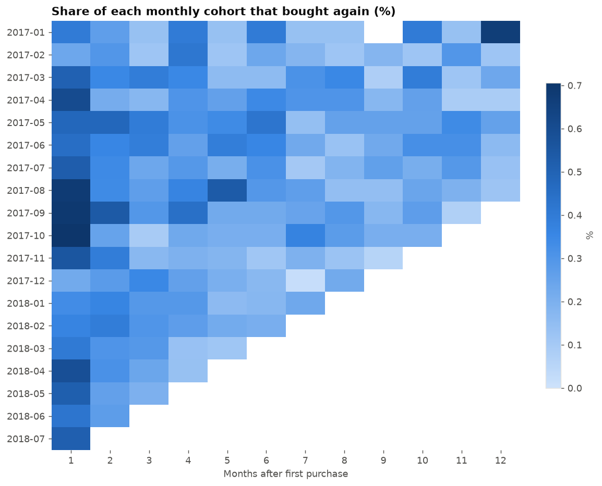
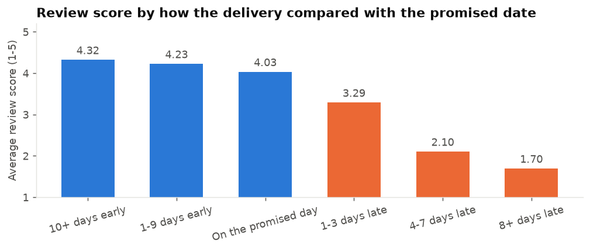
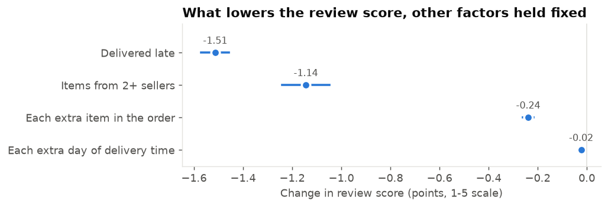
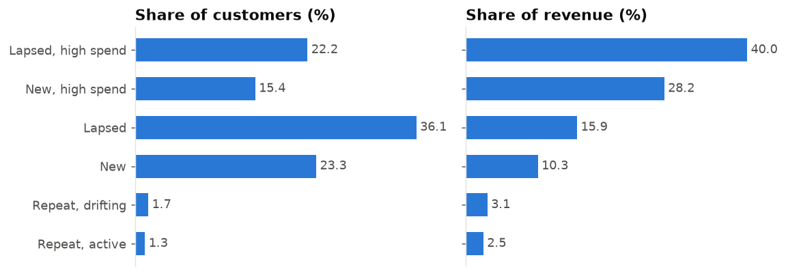

English | [Türkçe](README.tr.md)

# What drives repeat buying and bad reviews at a Brazilian marketplace

I took the public Olist dataset (about 99,000 orders placed between September 2016 and August 2018) and asked the questions an e-commerce analyst would get on a Monday morning: do customers come back, who are the valuable ones, and what makes people leave a bad review?

Almost all of the work is SQL. The raw CSVs are loaded into DuckDB and turned into a clean order table and a handful of summary tables by five SQL files in [`sql/`](sql). Python only loads the data, fits one regression and draws the charts.

## Dashboard

**[Open the live dashboard](https://beguumcetin.github.io/olist-ecommerce-analytics/)**. The source, [`docs/index.html`](docs/index.html), is a single-page dashboard with all of the below: monthly orders against late deliveries, review score by delivery delay, a state-by-state breakdown you can switch between lateness, delivery time and review score, the cohort heatmap and the customer segments. It has no dependencies. Download the file and open it in a browser, or serve the `docs/` folder with GitHub Pages. It follows the system light or dark theme and works on a phone.

Rebuild it after changing the SQL with `python -m src.analyze && python -m src.build_dashboard`.

## What I found

**Almost nobody comes back.** 97% of customers placed exactly one order, and only about 0.45% of a monthly cohort buys again in the following month. Repeat customers make up 3% of the customer base and 5.6% of revenue. A churn model would have little to work with here; at this marketplace growth comes almost entirely from new customers.



**A late delivery is the biggest single thing that hurts a review.** Orders that arrived on or before the promised date average 4.29 stars. Orders that arrived late average 2.27. The drop gets steeper the later the parcel is: 3.29 stars for 1 to 3 days late, 2.10 for 4 to 7 days, 1.70 for 8 days or more.



That gap is partly because late orders also differ in other ways (they travel further, they are bigger), so I fitted a regression that holds the product category, the customer's state, the number of items, the freight share of the price, the delivery time and the payment instalments fixed. Lateness still costs about 1.5 review points, with a 95% confidence interval of 1.46 to 1.57. In odds terms, a late order is about 7.8 times as likely to get a 1 or 2 star review.



**Late deliveries spiked twice, and volume does not explain both.** Orders went from 4,547 in October to 7,421 in November 2017 (Black Friday), and the share of late deliveries went from 4.2% to 12.4% in the same month. But the worst month was March 2018, with 19.0% of orders late and an average review of 3.76, on about the same volume as January 2018 (7,168 orders against 7,187), when only 5.7% were late. Something other than demand broke in February and March 2018; the data cannot say what.

**Lateness is a geography problem.** In São Paulo, 4.5% of deliveries are late and the average delivery takes 8.8 days. In Rio de Janeiro 12.1% are late, in Bahia 12.2% and in Ceará 13.8%, where the average delivery takes 21 days. Average review scores follow: 4.25 in São Paulo against 3.94 in Ceará.

**Orders with items from more than one seller get much worse reviews, and lateness does not explain it.** They are only 1.3% of delivered orders, but they average 2.86 stars against 4.17 for single-seller orders, and just 1% of them are marked late. My guess is that the items ship separately and the customer reviews the order while part of it is still on the way. The data cannot confirm that, because there is one delivery date per order, not per item. It is the first thing I would check with the logistics team.

## Customer segments

I scored every customer on how recently they bought and how much they spent, and split repeat buyers from one-time buyers because there are so few of the former.



"Lapsed, high spend" customers are 22% of people but 40% of revenue. The dataset only spans two years, so "lapsed" simply means a customer is not among the 40% who bought most recently, not that they are gone for good.

## How it is built

```
sql/01_staging.sql       typed views over the raw tables, latest review per order
sql/02_fct_orders.sql    one row per order: dates, delay, value, freight, category, review
sql/03_cohorts.sql       acquisition cohorts and monthly retention
sql/04_rfm.sql           recency, frequency, monetary scores and segments
sql/05_marts.sql         summary tables for dashboards (monthly, state, category, delivery)
src/load.py              CSV to DuckDB, then runs the SQL files in order
src/analyze.py           headline numbers, regression, CSV exports and the figures
src/build_dashboard.py   bakes the results into docs/index.html (template in dashboard/)
```

A few choices worth knowing about:

- Olist gives every order a new `customer_id`. The real person is `customer_unique_id`. Counting the first one makes everybody look like a one-time buyer.
- An order counts as late if it was delivered on a later calendar day than the estimate shown at checkout.
- A few orders have two reviews. I keep the most recent one.
- An order's category is the category of its most expensive item.
- 775 orders have no items in the dataset and are left out of the order table.

The summary tables are exported to [`reports/tables`](reports/tables) as CSV files, ready to load into Power BI or Tableau.

## Limits

This is observational data, so the regression shows what goes together with a bad review once other factors are held fixed, not what causes it. Review scores are also only available from customers who bothered to leave one. The data covers two years of one marketplace and ends in 2018. And since there is no experiment in it, I did not invent an A/B test.

## Run it yourself

Download the dataset from [Kaggle](https://www.kaggle.com/datasets/olistbr/brazilian-ecommerce) and put the zip or the unzipped folder in `data/raw/`.

```bash
python3 -m venv .venv
.venv/bin/pip install -r requirements.txt
.venv/bin/python -m src.load
.venv/bin/python -m src.analyze
```

Data: Olist, Brazilian E-Commerce Public Dataset, CC BY-NC-SA 4.0.
