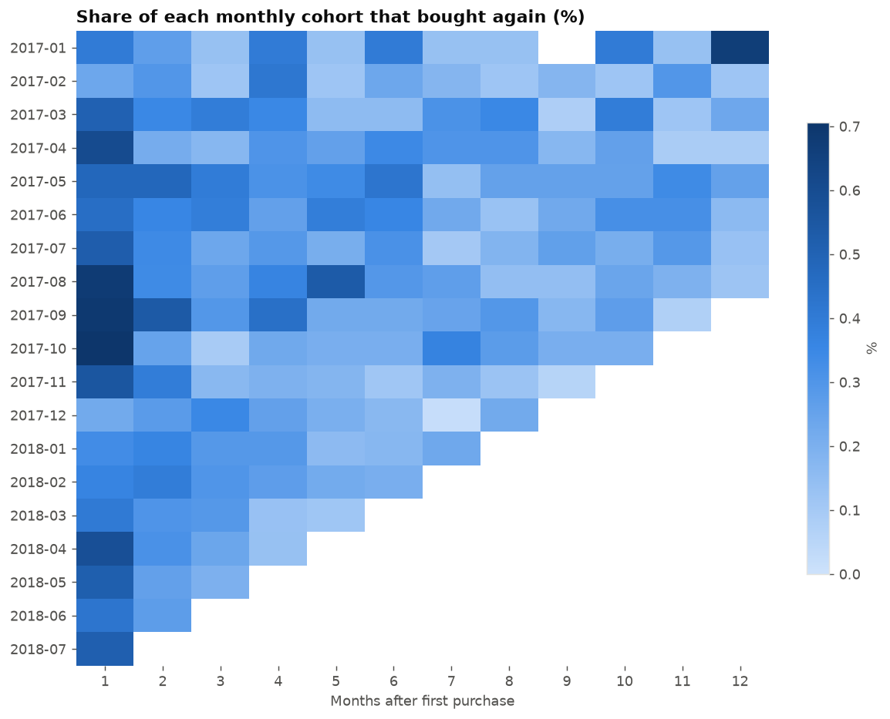
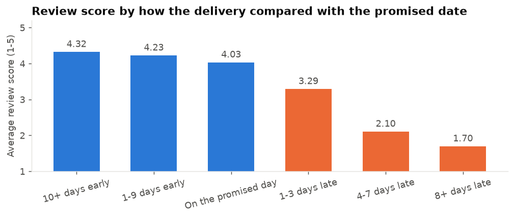
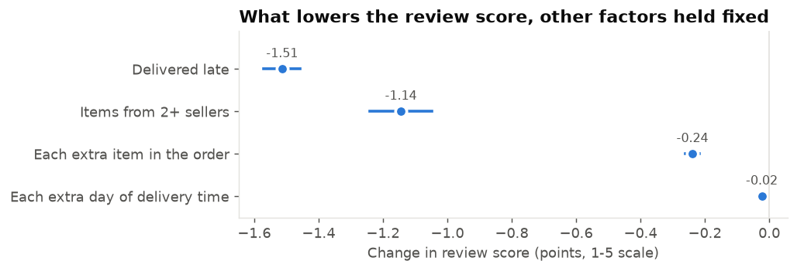
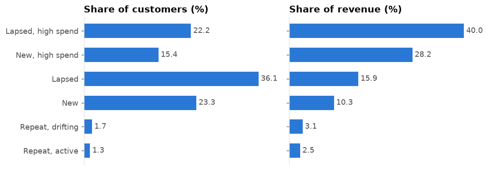

[English](README.md) | Türkçe

# Brezilyalı bir pazaryerinde tekrar alışverişi ve kötü yorumları ne belirliyor?

Herkese açık Olist veri setini (Eylül 2016 – Ağustos 2018 arasında verilmiş yaklaşık 99.000 sipariş) aldım ve bir e-ticaret analistine pazartesi sabahı gelebilecek soruları sordum: müşteriler geri geliyor mu, değerli olanlar kimler, insanlara kötü yorum yazdıran ne?

İşin neredeyse tamamı SQL. Ham CSV'ler DuckDB'ye yüklenir, [`sql/`](sql) klasöründeki beş SQL dosyası bunları temiz bir sipariş tablosuna ve birkaç özet tabloya çevirir. Python yalnızca veriyi yükler, bir regresyon kurar ve grafikleri çizer.

## Dashboard

**[Canlı dashboard'u aç](https://beguumcetin.github.io/olist-ecommerce-analytics/)** (arayüz İngilizce). Kaynağı [`docs/index.html`](docs/index.html), aşağıdakilerin hepsini içeren tek sayfalık bir dashboard: aylık sipariş sayısı ile geç teslimat oranı, teslimat gecikmesine göre yorum puanı, geç teslimat oranı / teslimat süresi / yorum puanı arasında geçiş yapabildiğiniz eyalet kırılımı, kohort ısı haritası ve müşteri segmentleri. Hiçbir bağımlılığı yok. Dosyayı indirip tarayıcıda açabilir ya da `docs/` klasörünü GitHub Pages ile yayınlayabilirsiniz. Sistemin açık ya da koyu temasını izler, telefonda da çalışır.

SQL'i değiştirdikten sonra yeniden üretmek için: `python -m src.analyze && python -m src.build_dashboard`.

## Ne buldum

**Neredeyse kimse geri gelmiyor.** Müşterilerin %97'si tam olarak bir sipariş verdi ve aylık bir kohortun yalnızca yaklaşık %0,45'i takip eden ayda yeniden alışveriş yapıyor. Tekrar alan müşteriler müşteri tabanının %3'ünü ve cironun %5,6'sını oluşturuyor. Bir müşteri kaybı modelinin burada üzerinde çalışacağı pek bir şey yok; bu pazaryerinde büyüme neredeyse tamamen yeni müşteriden geliyor.



**Geç teslimat, bir yorumu en çok bozan tek etken.** Söz verilen tarihte ya da öncesinde gelen siparişler ortalama 4,29 yıldız alıyor. Geç gelenler ortalama 2,27. Paket ne kadar geç gelirse düşüş o kadar sertleşiyor: 1–3 gün gecikmede 3,29 yıldız, 4–7 günde 2,10, 8 gün ve üzerinde 1,70.



Bu farkın bir kısmı, geç gelen siparişlerin başka açılardan da farklı olmasından geliyor (daha uzağa gidiyorlar, daha büyükler). Bu yüzden ürün kategorisini, müşterinin eyaletini, ürün sayısını, kargo bedelinin fiyata oranını, teslimat süresini ve taksit sayısını sabit tutan bir regresyon kurdum. Geç teslimat yine de yaklaşık 1,5 yorum puanına mal oluyor; %95 güven aralığı 1,46 ile 1,57. Odds cinsinden, geç gelen bir siparişin 1 ya da 2 yıldız alma olasılığı yaklaşık 7,8 kat.



**Geç teslimatlar iki kez sıçradı ve hacim ikisini de açıklamıyor.** Siparişler 2017 Ekim'inde 4.547'den Kasım'da 7.421'e çıktı (Black Friday) ve geç teslimat payı aynı ayda %4,2'den %12,4'e çıktı. Ama en kötü ay 2018 Mart'ıydı: siparişlerin %19,0'ı geç geldi, ortalama yorum 3,76 oldu; hacim ise 2018 Ocak ayına yakındı (Mart'ta 7.168, Ocak'ta 7.187 sipariş) ve Ocak'ta yalnızca %5,7 geç gelmişti. Şubat ve Mart 2018'de talep dışında bir şey bozuldu; veri bunun ne olduğunu söylemiyor.

**Geç teslimat bir coğrafya sorunu.** São Paulo'da teslimatların %4,5'i geç ve ortalama teslimat 8,8 gün sürüyor. Rio de Janeiro'da %12,1, Bahia'da %12,2, Ceará'da %13,8 geç; Ceará'da ortalama teslimat 21 gün. Ortalama yorum puanları da aynı yönde: São Paulo'da 4,25, Ceará'da 3,94.

**Birden fazla satıcıdan ürün içeren siparişler çok daha kötü yorum alıyor ve geç teslimat bunu açıklamıyor.** Teslim edilen siparişlerin yalnızca %1,3'ü bu türden, ama ortalama 2,86 yıldız alıyorlar; tek satıcılı siparişlerde bu 4,17. Üstelik yalnızca %1'i geç işaretli. Tahminim, ürünlerin ayrı ayrı gönderilmesi ve müşterinin siparişin bir kısmı hâlâ yoldayken yorum yazması. Veri bunu doğrulayamıyor, çünkü her siparişin tek bir teslimat tarihi var, ürün başına yok. Lojistik ekibiyle ilk kontrol edeceğim şey bu olurdu.

## Müşteri segmentleri

Her müşteriyi ne kadar yakın zamanda ve ne kadar harcayarak alışveriş yaptığına göre puanladım; tekrar alanlar çok az olduğu için onları tek seferlik alıcılardan ayırdım.



"Lapsed, high spend" (uzaklaşmış, yüksek harcamalı) müşteriler insanların %22'si ama cironun %40'ı. Veri seti yalnızca iki yılı kapsadığı için "lapsed" sadece müşterinin en son alışveriş yapan %40'ın içinde olmadığı anlamına geliyor, kalıcı olarak kaybedildiği anlamına değil.

## Nasıl kuruldu

```
sql/01_staging.sql       ham tablolar üzerinde tipli görünümler, sipariş başına son yorum
sql/02_fct_orders.sql    sipariş başına bir satır: tarihler, gecikme, tutar, kargo, kategori, yorum
sql/03_cohorts.sql       edinim kohortları ve aylık tutma oranı
sql/04_rfm.sql           yenilik, sıklık, parasal değer skorları ve segmentler
sql/05_marts.sql         dashboard için özet tablolar (aylık, eyalet, kategori, teslimat)
src/load.py              CSV'den DuckDB'ye, sonra SQL dosyalarını sırayla çalıştırır
src/analyze.py           özet rakamlar, regresyon, CSV çıktıları ve grafikler
src/build_dashboard.py   sonuçları docs/index.html içine gömer (şablon dashboard/ altında)
```

Bilinmesi gereken birkaç tercih:

- Olist her siparişe yeni bir `customer_id` verir. Gerçek kişi `customer_unique_id`'dir. İlkini saymak herkesi tek seferlik alıcı gösterir.
- Bir sipariş, ödeme sırasında gösterilen tahmini tarihten sonraki bir takvim gününde teslim edildiyse geç sayılır.
- Bazı siparişlerin iki yorumu var. En yenisini tutuyorum.
- Bir siparişin kategorisi, en pahalı ürününün kategorisidir.
- 775 siparişin veri setinde hiç ürünü yok ve sipariş tablosunun dışında bırakıldı.

Özet tablolar [`reports/tables`](reports/tables) altına CSV olarak aktarılıyor; Power BI ya da Tableau'ya doğrudan yüklenebilir.

## Sınırlar

Bu gözlemsel bir veri; regresyon, diğer etkenler sabit tutulduğunda kötü yorumla nelerin birlikte gittiğini gösteriyor, nelerin sebep olduğunu değil. Yorum puanları da yalnızca yorum yazma zahmetine katlanan müşterilerden geliyor. Veri tek bir pazaryerinin iki yılını kapsıyor ve 2018'de bitiyor. İçinde deney olmadığı için uydurma bir A/B testi yapmadım.

## Kendiniz çalıştırın

Veri setini [Kaggle](https://www.kaggle.com/datasets/olistbr/brazilian-ecommerce)'dan indirin, zip'i ya da açılmış klasörü `data/raw/` içine koyun.

```bash
python3 -m venv .venv
.venv/bin/pip install -r requirements.txt
.venv/bin/python -m src.load
.venv/bin/python -m src.analyze
```

Veri: Olist, Brazilian E-Commerce Public Dataset, CC BY-NC-SA 4.0.
